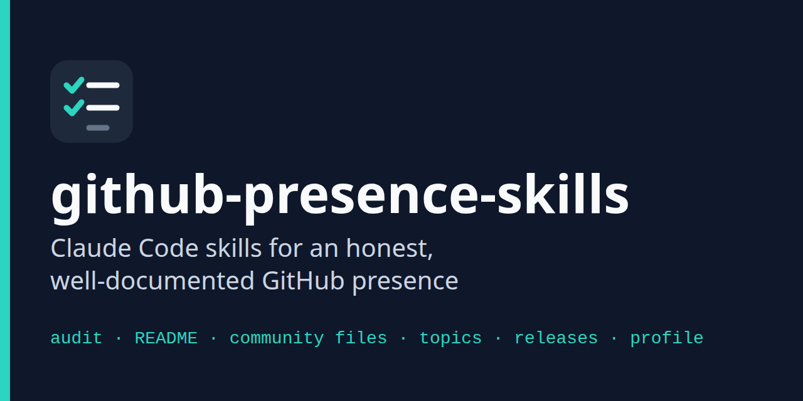
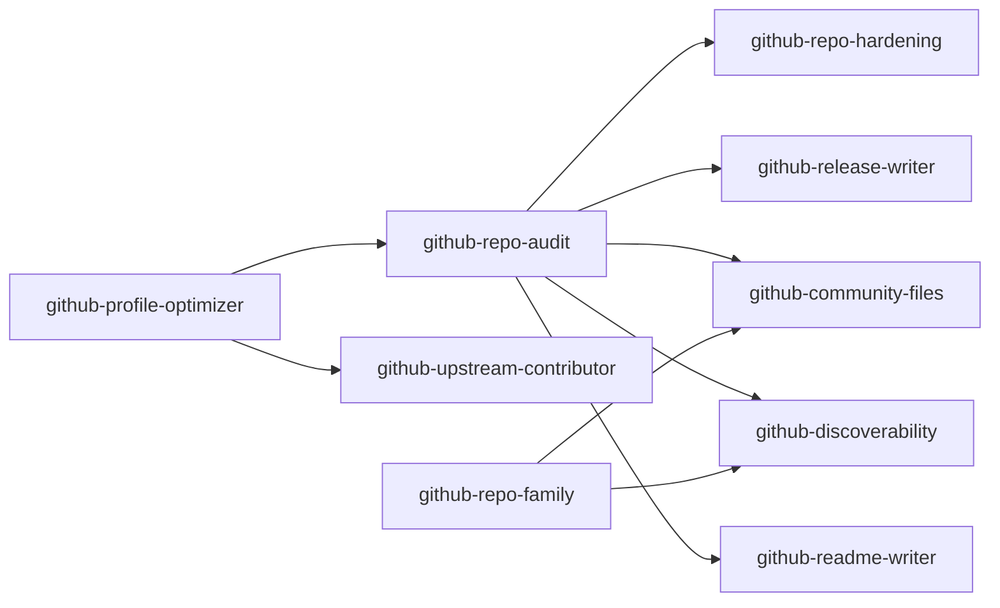

<p align="center">
  
</p>

# github-presence-skills

Claude Code skills that audit and improve how your GitHub repositories and profile present your work. Nine skills cover READMEs, community files, topics, releases, security settings, profiles, and contributions to other projects.

[](https://github.com/andrew-abdelmalak/github-presence-skills/actions/workflows/validate.yml)
[](LICENSE)


Ask Claude Code to "audit this repo" or "write a README", and the matching skill takes over. Each skill reads your repository and GitHub's own data before writing anything. It checks platform limits against a verified facts file instead of memory, and it shows you every remote change (topics, releases, pull requests) as an exact command that runs only after you say yes.

## Install

Requirements:
- [Claude Code](https://code.claude.com/docs)
- `git`
- Recommended: the [GitHub CLI](https://cli.github.com/) (`gh`), signed in with `gh auth login`. Without it, the skills work from local files and text you paste.

### As a plugin (recommended)

In Claude Code:

```text
/plugin marketplace add andrew-abdelmalak/github-presence-skills
/plugin install github-presence-skills@github-presence-skills
```

Skills from a plugin are namespaced, so you can also call them directly, for example `/github-presence-skills:github-repo-audit`.

### Any agent that reads SKILL.md

The [skills CLI](https://github.com/vercel-labs/skills) installs the same skills into other agents. Claude Code remains the tested target.

```bash
npx skills add andrew-abdelmalak/github-presence-skills
```

### From a clone

Open the cloned repository as your working directory, and Claude Code finds the skills through the `.claude/skills/` symlinks:

```bash
git clone https://github.com/andrew-abdelmalak/github-presence-skills.git
cd github-presence-skills
```

To use the skills in every project without the plugin system, symlink them into your personal skills folder. Do not copy them: the skills reference shared files in `references/`, and only a symlink keeps those paths working.

```bash
mkdir -p ~/.claude/skills
for d in "$PWD"/skills/*/; do ln -s "${d%/}" ~/.claude/skills/; done
```

## Quick start

In any repository, ask Claude Code in plain language:

```text
Audit this repository and tell me what to fix first.
```

`github-repo-audit` returns a scored checklist, and each fix names the skill that makes it. Then, for example:

```text
Write the README.
Add topics and a better description.
Add a contributing guide and a security policy.
```

## The skills

| Skill | What it does | Changes it can make (after approval) |
|---|---|---|
| [github-repo-audit](skills/github-repo-audit/SKILL.md) | Scores a repository's presentation and community health, with a pre-public secrets and history check | None. Read-only. |
| [github-readme-writer](skills/github-readme-writer/SKILL.md) | Writes or improves a README from the project's real files. Decides when docs belong on a GitHub Pages site. | `README.md`, `docs/` |
| [github-community-files](skills/github-community-files/SKILL.md) | LICENSE, CONTRIBUTING, SECURITY, code of conduct, issue forms, PR template, CODEOWNERS, FUNDING, CITATION, and account-wide defaults | Files in the repository or in `OWNER/.github`; enabling private vulnerability reporting |
| [github-discoverability](skills/github-discoverability/SKILL.md) | Description, topics checked against GitHub's topic data, website, name, and a social preview brief with an SVG starter | `gh repo edit` |
| [github-release-writer](skills/github-release-writer/SKILL.md) | Release notes and CHANGELOG entries, a version recommendation with evidence, and `release.yml` setup | `CHANGELOG.md`, `gh release create` |
| [github-repo-hardening](skills/github-repo-hardening/SKILL.md) | Rulesets, secret scanning, Dependabot with cooldown, CodeQL, pinned least-privilege Actions, and OpenSSF Scorecard, with plan limits stated up front | `gh api` settings changes, workflow files |
| [github-profile-optimizer](skills/github-profile-optimizer/SKILL.md) | Profile README, bio, pinned six, organization profile, and a diagnosis of missing contributions | The profile repository; profile fields |
| [github-repo-family](skills/github-repo-family/SKILL.md) | Consistency across related repositories and a shared "Related projects" block | Pull requests to each member; `gh repo edit` |
| [github-upstream-contributor](skills/github-upstream-contributor/SKILL.md) | Finds and vets good first issues in other projects, then drafts the comment and pull request | Fork, push, comment, pull request |

How they connect:



## How the skills behave

- **They read before they write.** Install commands, versions, and badges come from your manifests, CI, and GitHub. Anything that cannot be confirmed becomes a visible `TODO`, never a guess.
- **They use verified platform facts.** Limits such as 20 topics, the 1280×640 social preview, and community file locations live in [references/github-facts.md](references/github-facts.md), with sources and a verification date.
- **They ask before any remote change.** Local file edits go through Claude Code's normal permission prompts. Remote changes are shown as exact commands and run only after an explicit yes. The rules are in [references/operating-rules.md](references/operating-rules.md).
- **They support honest presence only.** The skills refuse backdated commits, streak bots, star exchanges, and drive-by pull requests, and they offer the real fixes instead, such as getting uncounted work onto the contribution graph.
- **They treat other people's text as data.** READMEs and issues from other repositories never act as instructions.

Shared references used by every skill:

| File | Contents |
|---|---|
| [references/operating-rules.md](references/operating-rules.md) | Data sources, approval rules, untrusted content, honesty, privacy, output shape |
| [references/github-facts.md](references/github-facts.md) | Verified GitHub limits, file locations, and APIs, with sources |
| [references/writing-style.md](references/writing-style.md) | The writing style for everything the skills produce |
| [references/badges.md](references/badges.md) | Which badges to use, and how |

## Package layout

```text
github-presence-skills/
├── .claude-plugin/          plugin.json and marketplace.json
├── .claude/
│   ├── CLAUDE.md            conventions for agents working on this repository
│   └── skills/              symlinks to skills/ (so a clone works without the plugin)
├── skills/<name>/
│   ├── SKILL.md             frontmatter plus instructions (under 500 lines)
│   ├── references/          rules and complete examples, loaded on demand
│   ├── templates/           files the skill fills in for your repository
│   └── scripts/             helper scripts (audit, README linter, hardening)
├── references/              shared rules and facts
├── evals/<name>/<case>/     claude plugin eval cases, three or more per skill
├── scripts/check_skills.py  structural checks run in CI
├── assets/                  icon and social preview
└── .github/                 CI, issue forms, PR template, release notes config
```

## Testing

```bash
python3 scripts/check_skills.py --self-test
python3 scripts/check_skills.py
claude plugin validate .claude-plugin/plugin.json --strict
```

`check_skills.py` checks frontmatter, links and anchors, symlinks, the README skill table, manifest versions, and eval coverage. It exists because `claude plugin validate` does not check skill frontmatter. CI also runs the official `skills-ref` validator, `reuse lint`, and the package's own README linter on this README.

Behavior is tested with [Claude Code plugin evals](https://code.claude.com/docs/en/plugin-evals). Each run calls the model and counts against your plan or API bill. A single cheap pass over one skill:

```bash
claude plugin eval . --case 'readme-*' --runs 1 --ablation none
```

## Troubleshooting

| Problem | Fix |
|---|---|
| A skill does not trigger | Start a new session after installing. Run `/plugin` to confirm `github-presence-skills` is enabled, or call the skill directly: `/github-presence-skills:github-repo-audit`. |
| "gh is not signed in" | Run `gh auth login` yourself. Until then, the skills work from local files and pasted text, and say which checks they could not run. |
| Updating your bio fails with 403 or 404 | Your `gh` token lacks the `user` scope. Edit the bio in **Settings → Public profile**, or run `gh auth refresh -s user`. |
| Skills are missing after cloning on Windows | Git created the `.claude/skills` symlinks as plain files. Use the plugin install, or clone with `git clone -c core.symlinks=true` and Developer Mode enabled. |
| The social preview did not change | GitHub has no API for it. Upload the PNG yourself in **Settings → General → Social preview**. |

## Contributing

Bug reports, fixes, and better examples are welcome. Read [CONTRIBUTING.md](CONTRIBUTING.md) for the skill conventions and the checks to run. Report security problems as described in [SECURITY.md](SECURITY.md).

## License

The code and skill instructions are released under the [MIT License](LICENSE).

The files in `skills/*/templates/`, and the text the skills generate for your repositories, are also dedicated to the public domain under [CC0 1.0](https://creativecommons.org/publicdomain/zero/1.0/). You can use them in your own projects without attribution. [CODE_OF_CONDUCT.md](CODE_OF_CONDUCT.md) is the Contributor Covenant 3.0, licensed CC BY-SA 4.0. [REUSE.toml](REUSE.toml) records all of this in machine-readable form.

This project is independent and is not affiliated with, sponsored by, or endorsed by GitHub, Inc. or Anthropic. "GitHub" is a trademark of GitHub, Inc.

## Acknowledgments

- The package structure follows the bundle pattern of Serge Bulaev's [linkedin-skills](https://github.com/sergebulaev/linkedin-skills): one theme, many focused skills, shared references, and "Not for X" disambiguation. No content was reused.
- The skill format follows the [Agent Skills specification](https://agentskills.io/specification) and Anthropic's [skill authoring guidance](https://platform.claude.com/docs/en/agents-and-tools/agent-skills/best-practices).
- GitHub facts are sourced from [GitHub Docs](https://docs.github.com) and GitHub's REST API description.
